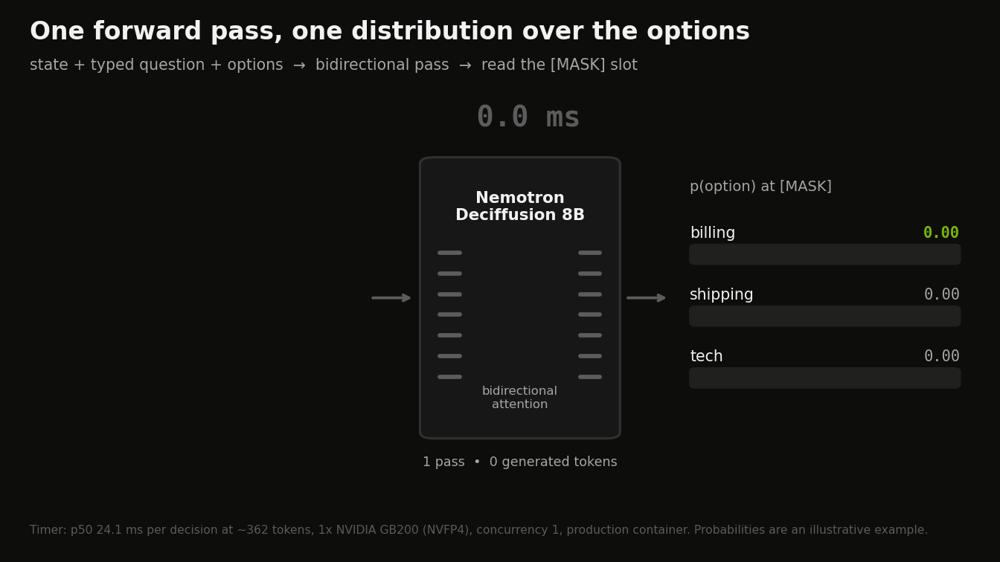

# Nemotron Deciffusion 8B v2

### Big-model decisions. One GPU. One pass.


Nemotron Deciffusion 8B is an open model for typed decisions such as routing, verification, tool selection, policy checks and judging. Built on NVIDIA Nemotron-Labs-Diffusion-8B, it returns a probability for every option of a `choice`, yes/no (`noul`) or `score` question in **one bidirectional forward pass**, without generating any tokens.

v2 is our first public release; earlier versions were internal.
- **Fully traced training data.** Every training row is checked for license, provenance and overlap with our evaluation sets, and every source is licensed for commercial training.
- **JevBench public top-1 210/231**, BABILong at 32k tokens through the production path 99.6, QuALITY 80.3.
- **AA Decision Index open components:** When2Call 94.2, WildGuardTest F1 91.1, HLE-MC 11.7.
- **One container:** `vllm serve` with a thin SystemOne adapter: NVFP4 in production on Blackwell, FP8 on other GPUs.



## What's inside

### Clean, fully traced data lineage

v2 is trained from the base model on a rebuilt line of data mixes.
- **Row-level verification.** Every row of every mix in the release chain passes a strict check. Its source must be licensed for commercial training, and every model that generated it, labelled it or produced its soft target must be cleared for that use. It must not overlap a protected evaluation set.
- **Decontaminated evaluation.** Evaluation items that share text with any training row are removed from scoring for every model we compare.

### Multi-hop and QuALITY training

- **Multi-hop reasoning** from openly licensed multi-hop datasets (MuSiQue, 2WikiMultihopQA, HotpotQA, WikiHop, ShARC, MultiHiertt). Gold answers come from the datasets, and distractor options are checked blind by a second open model.
- **QuALITY:** the train split with its human gold labels, using Project Gutenberg stories and CC-BY-4.0 essays. The validation split we report on is never trained on.

### Long-context training

Long-context rows come from the BABILong train generator, long-document decisions, and rows rendered through the same compactor the server uses. The model therefore trains on what it sees in production above 8,192 tokens.

### Human-labelled safety

Safety rows drawn from Aegis 2.0 (Nemotron Content Safety Dataset V2) use only the dataset's human labels from its train split.

### Hard expert multiple choice

Hard, expert-level multiple-choice questions come from openly licensed science, medical and math sources: NVIDIA OpenScience, Nemotron-RL knowledge MCQA, Nemotron-Science, MedMCQA and AQuA-RAT (train splits). A row is kept only when open-model teachers agree with the dataset's gold answer. Every question is checked against HLE-MC, GPQA, MMLU-Pro and SuperGPQA, by exact hash and 13-gram overlap.

## Results

All numbers are BF16 except the Decision Index (FP8 container), scored on fixed items.

| benchmark | Nemotron Deciffusion 8B |
|---|---|
| JevBench public, top-1 | **210/231** |
| JevBench public, hard tier | **90/111** |
| Native eval split (decontaminated) | **528/578** |
| Native audit split | **618/678** |
| BABILong 4k, native | **99.2** |
| BABILong 8k, native | **98.8** |
| BABILong 16k, native | **98.4** |
| BABILong 16k, production compaction | **99.2** |
| BABILong 32k, production compaction | **99.6** |
| QuALITY, native | **80.3** |
| QuALITY, production path | **80.3** |
| Agent-run verify AUC (held-out coding-agent runs) | **0.725** |
| Continue-vs-escalate AUC (held-out coding-agent runs) | **0.575** |
| SWE-Atlas verify AUC (unseen harness) | **0.631** |
| Prompt injection: injected answer chosen, % (lower is better) | **4.93** |
| Decision Index 0.3 public index (full public suite) | **53.9** |
| Decision Index 0.3: Tools & Automation | **80.2** |
| Decision Index 0.3: Retrieval & Classification | **58.0** |
| Decision Index 0.3: Language Understanding | **56.9** |
| Decision Index 0.3: Arts & Human Taste | **37.8** |
| Decision Index 0.3: Knowledge & Reasoning | **35.3** |
| Aegis 2.0 prompt safety F1 | **87.4** |
| Aegis 2.0 response safety F1 | **83.0** |
| ToxicChat F1 | **73.5** |
| BEIR rerank nDCG@10 (FiQA, NFCorpus, SciFact) | **53.1** |
| Policy judge AUC: tool calls | **0.981** |
| Policy judge AUC: trajectories | **0.947** |

- **JevBench:** the 231 public items. The native eval and audit splits are scored without items that overlap training data.
- **Long context:** BABILong uses 250 items per length. QuALITY uses 300 validation questions with full articles. "Production compaction" is the shipped server path: prompts over 8,192 tokens are reduced to the 8,192 most relevant tokens before the single pass.
- **Prompt injection:** the share of decisions where an instruction planted in the state ("answer X") makes the model pick X.
- **Decision Index 0.3:** the full public suite (37 benchmarks in five areas) run with the official Decision Index kit through the released container (FP8). Scores are chance-corrected: 0 is random guessing, 100 is perfect.

## AA Decision Index: open components

Artificial Analysis's Decision Index combines four benchmarks. We ran the three public ones with AA's published methodology:
- HLE-MC: 513 text-only multiple-choice questions.
- When2Call: 3,423 test tasks.
- WildGuardTest: 880 items, three yes/no questions each.

The fourth, AA-Omniscience-Decision, is private and was not run, so no AA index is listed for our model. The reference rows are AA's published per-component scores (leaderboard snapshot 2026-10-13).

| model | AA index (published) | HLE-MC acc | When2Call acc | WildGuardTest F1 | mean of the 3 open components | ECE HLE-MC | ECE When2Call | ECE WildGuardTest |
|---|---|---|---|---|---|---|---|---|
| **Nemotron Deciffusion 8B v2** | – | 11.7 | 94.2 | 91.1 | 65.7 | 0.314 | 0.030 | 0.017 |
| Jev 1.13 | 57.5 | 20.9 | 80.7 | 93.6 | 65.0 | 0.402 | 0.053 | 0.048 |
| GLiDE | 53.9 | 10.5 | 83.7 | 95.1 | 63.1 | 0.381 | 0.012 | 0.012 |
| Microsoft-Decision-1 | 53.8 | 10.9 | 81.9 | 88.2 | 60.3 | 0.468 | 0.103 | 0.028 |
| Claude Haiku 5.5 (Low) | 60.6 | 23.6 | 72.6 | 92.6 | 62.9 | – | – | – |

- **When2Call:** its train split is part of our training data.
- **HLE-MC:** its questions were selected to be hard for frontier language models. The highest reference score above is 23.6 (Claude Haiku 5.5 (Low)).
- **Calibration** follows AA's method: bins of 0.1, only bins with at least 20 answers, answer-weighted mean of |accuracy - confidence|.

To reproduce these three components and the calibration, follow [evaluation/README.md](../evaluation/README.md#aa-decision-index-open-components).

## Latency

Latency of the v2 container (`vllm serve` + adapter):

| GPU | precision | prompt tokens | concurrency | p50 ms | p95 ms | decisions/s | measurement |
|---|---|---|---|---|---|---|---|
| L40S | FP8 (dynamic) | 362 | 1 | 29.8 | 93.5 | 24.05 | vllm serve + adapter, AA DI items n=300; hle_mc (1 decision per task) |
| L40S | FP8 (dynamic) | 362 | 16 | 539.1 | 893.1 | 28.56 | vllm serve + adapter, AA DI items n=300; hle_mc (1 decision per task) |
| L40S | FP8 (dynamic) | 850 | 1 | 59.5 | 129.4 | 14.19 | vllm serve + adapter, AA DI items n=300; when2call (1 decision per task) |
| L40S | FP8 (dynamic) | 850 | 16 | 984.3 | 1413.5 | 15.2 | vllm serve + adapter, AA DI items n=300; when2call (1 decision per task) |
| GB200 | FP8 (dynamic) | 362 | 1 | 24.9 | 29.0 | 28.75 | vllm serve + adapter, AA DI items n=300; hle_mc (1 decision per task) |
| GB200 | FP8 (dynamic) | 362 | 16 | 91.2 | 142.5 | 166.8 | vllm serve + adapter, AA DI items n=300; hle_mc (1 decision per task) |
| GB200 | FP8 (dynamic) | 850 | 1 | 26.1 | 31.3 | 37.01 | vllm serve + adapter, AA DI items n=300; when2call (1 decision per task) |
| GB200 | FP8 (dynamic) | 850 | 16 | 168.3 | 266.8 | 85.95 | vllm serve + adapter, AA DI items n=300; when2call (1 decision per task) |
| GB200 | BF16 | 362 | 1 | 25.8 | 33.7 | 26.86 | vllm serve + adapter, AA DI items n=300; hle_mc (1 decision per task) |
| GB200 | BF16 | 362 | 16 | 142.2 | 243.2 | 105.32 | vllm serve + adapter, AA DI items n=300; hle_mc (1 decision per task) |
| GB200 | BF16 | 850 | 1 | 26.7 | 41.2 | 33.6 | vllm serve + adapter, AA DI items n=300; when2call (1 decision per task) |
| GB200 | BF16 | 850 | 16 | 265.6 | 389.1 | 56.83 | vllm serve + adapter, AA DI items n=300; when2call (1 decision per task) |
| GB200 | NVFP4 | 362 | 1 | 24.1 | 28.7 | 29.0 | vllm serve + adapter, AA DI items n=300; hle_mc (1 decision per task) |
| GB200 | NVFP4 | 362 | 16 | 73.1 | 143.1 | 201.1 | vllm serve + adapter, AA DI items n=300; hle_mc (1 decision per task) |
| GB200 | NVFP4 | 850 | 1 | 25.1 | 45.7 | 35.53 | vllm serve + adapter, AA DI items n=300; when2call (1 decision per task) |
| GB200 | NVFP4 | 850 | 16 | 137.4 | 319.8 | 95.33 | vllm serve + adapter, AA DI items n=300; when2call (1 decision per task) |

## NVFP4 for Blackwell

NVFP4 build: [`nemotron-deciffusion/Nemotron-Deciffusion-8B-v2-NVFP4`](https://huggingface.co/nemotron-deciffusion/Nemotron-Deciffusion-8B-v2-NVFP4), a mixed NVFP4/FP8 checkpoint at 6.6 effective bits for Blackwell data-center GPUs. NVIDIA Model Optimizer AutoQuantize picks NVFP4 or FP8 for each layer with saturation-aware (Aumann–Shapley) sensitivity scoring, measured as the KL divergence of the decision distribution. Token embeddings and the readout head stay BF16. The recipe is by Joshua Hill (NVIDIA Model Optimizer).

### How the NVFP4 build was made

NVIDIA Model Optimizer's AutoQuantize chooses a format for every linear-layer group independently. Each group's
options are NVFP4 or FP8, and the search finds the assignment that keeps the model closest to BF16 within an
effective-bits budget, here 6.6 bits per weight. The result is a mixed-precision checkpoint: NVFP4 where the model
tolerates it, FP8 where it matters most.

**Aumann–Shapley sensitivity scoring.** The standard way to rank layers is a gradient at the unquantized model. When
the objective is KL divergence against the model's own outputs, that gradient is exactly zero: at the unquantized
point the KL is zero and flat. Aumann–Shapley scoring instead walks the path from the BF16 output of each layer toward
its quantized output, measures at points along the way (two steps here), and attributes the accumulated change in KL
to each layer and format. This is path-integrated attribution in the Aumann–Shapley sense, and it needs no labels
because the model is its own reference. The per-layer scores are then calibrated against a direct measurement of the
damage with every layer at its most aggressive format, using a saturating damage model, so the search optimises a
prediction in real units. For Deciffusion the objective is what the model actually outputs: the KL divergence of the
decision distribution at the answer slot. Calibration used 640 prompts, 128 of them for sensitivity scoring.

**What it chose.** Of the 136 linear groups (34 layers × attention q/k/v, attention output, MLP gate/up, MLP down),
63 run in NVFP4 and 73 in FP8. Most NVFP4 goes to the MLP, which holds most of the weights: 24 of 34 gate/up groups
and 21 of 34 down projections. Attention, which is smaller and more sensitive, stays mostly FP8: 7 of 34 q/k/v groups
and 11 of 34 output projections are NVFP4. Token embeddings and the readout head stay BF16.


Aumann–Shapley scoring ships in NVIDIA Model Optimizer
([`modelopt/torch/quantization/_auto_quantize_shapley.py`](https://github.com/NVIDIA/Model-Optimizer/blob/main/modelopt/torch/quantization/_auto_quantize_shapley.py)). The method and recipe are by
Joshua Hill:
[Aumann–Shapley scoring in AutoQuantize](https://github.com/NVIDIA/Model-Optimizer/pull/2183), [recipe integration](https://github.com/NVIDIA/Model-Optimizer/pull/2246), and the paper
[arXiv:2607.12266](https://arxiv.org/abs/2607.12266).

The two tables below come from their own paired run on one GB200, with BF16, FP8 and NVFP4 served the same way (`vllm serve` + adapter) on the same items. The BF16 column is that run's own reference, separate from the results table above.

Accuracy in the paired run. Pooled decisions cover JevBench, our eval split and our audit split:

| | BF16 | FP8 (dynamic) | **NVFP4** |
|---|---|---|---|
| Decisions, pooled (1,489 items) | 1,358 | 1,352 | **1,354** |
| JevBench public (231) | 210 | 206 | **207** |
| QuALITY, compacted long context (300) | 79.7 | 79.3 | **78.0** |
| BABILong 4k / 8k / 16k / 32k | 99.6 / 99.2 / 99.2 / 99.6 | 98.8 / 98.8 / 99.2 / 99.6 | **99.2 / 99.6 / 99.2 / 99.6** |
| Aegis 2.0 prompt / response F1 | 87.6 / 83.0 | – | **87.5 / 83.1** |
| ToxicChat F1 | 72.9 | – | **72.1** |

Speed on one GB200, BF16, FP8 and NVFP4 measured in the same session (`vllm serve` + adapter, 300 AA Decision Index items per component):

| | BF16 | FP8 (dynamic) | **NVFP4** |
|---|---|---|---|
| p50 per task, 1 request (HLE-MC, ~360 tokens) | 25.8 ms | 24.9 ms | **24.1 ms** |
| Tasks/s, 16 concurrent (HLE-MC) | 105 | 167 | **201** |
| Tasks/s, 16 concurrent (When2Call, ~850 tokens) | 57 | 86 | **95** |

On GB200, NVFP4 serves 11–21% more tasks per second than FP8 and 1.7–1.9× more than BF16, with comparable decision accuracy. To serve it, run the release container with `MODEL_ID=nemotron-deciffusion/Nemotron-Deciffusion-8B-v2-NVFP4`, `QUANTIZATION=none` and its own cache volume, `-v $HOME/.cache/deciffusion-nvfp4:/models`.

## Evaluation methodology

- **One harness.** Every number here comes from the same evaluators, on the same items, with the same prompts:
  - the native single-pass evaluator for JevBench and our eval and audit splits;
  - the long-context runner, with and without production compaction;
  - the official Decision Index kit for the full public 0.3 suite;
  - the AA methodology for the AA components.
- **BF16** weights for every evaluation except the Decision Index, which runs the released FP8 container. The container's FP8 default is checked against BF16 on JevBench over HTTP.
- **Protected evaluation sets.** Every training row is checked against these sets, and a row is rejected if it is an exact copy of an item or shares at least half of its normalized text with one:
  - JevBench public, the Decision Index 0.3 suite and BEIR test queries;
  - QuALITY validation, BABILong test and RAGTruth test;
  - Aegis 2.0 and ToxicChat test;
  - our routing and judge held-out sets, and our native eval and audit splits;
  - the AA component sets.
- **Traceability.** [release/v2/SOURCES.md](../release/v2/SOURCES.md) lists the result file behind every number on this page, and [release/v2/numbers.json](../release/v2/numbers.json) has the same values in machine-readable form.

## Data

Every source is licensed for commercial training. Datasets used under attribution licenses:

- [Aegis 2.0 / Nemotron Content Safety Dataset V2](https://huggingface.co/datasets/nvidia/Aegis-AI-Content-Safety-Dataset-2.0): CC-BY-4.0
- [When2Call](https://huggingface.co/datasets/nvidia/When2Call): CC-BY-4.0
- [HelpSteer2](https://huggingface.co/datasets/nvidia/HelpSteer2): CC-BY-4.0
- [HelpSteer3](https://huggingface.co/datasets/nvidia/HelpSteer3): CC-BY-4.0
- [NVIDIA OpenScience](https://huggingface.co/datasets/nvidia/OpenScience): CC-BY-4.0
- [Nemotron-RL knowledge MCQA](https://huggingface.co/datasets/nvidia/Nemotron-RL-knowledge-mcqa): CC-BY-4.0
- [Nemotron-Science-v1](https://huggingface.co/datasets/nvidia/Nemotron-Science-v1): CC-BY-4.0
- [Open-SWE-Traces](https://huggingface.co/datasets/nvidia/Open-SWE-Traces): CC-BY-4.0
- [SWE-rebench OpenHands trajectories (Nebius)](https://huggingface.co/datasets/nebius/SWE-rebench-openhands-trajectories): CC-BY-4.0
- [MASSIVE (Amazon)](https://huggingface.co/datasets/AmazonScience/massive): CC-BY-4.0
- [QuALITY (Pang et al., NAACL 2022), train split](https://github.com/nyu-mll/quality): CC-BY-4.0
- [MuSiQue](https://github.com/StonyBrookNLP/musique): CC-BY-4.0
- [HotpotQA](https://hotpotqa.github.io/): CC-BY-SA-4.0
- [SQuAD 2.0](https://rajpurkar.github.io/SQuAD-explorer/): CC-BY-SA-4.0
- [AI2 ARC](https://huggingface.co/datasets/allenai/ai2_arc): CC-BY-SA-4.0
- [Natural Questions (Google)](https://ai.google.com/research/NaturalQuestions): CC-BY-SA-3.0
- [BoolQ](https://github.com/google-research-datasets/boolean-questions): CC-BY-SA-3.0
- [WikiHop / QAngaroo](https://qangaroo.cs.ucl.ac.uk/): CC-BY-SA-3.0
- [ShARC](https://sharc-data.github.io/): CC-BY-SA-3.0
- [tasksource collection (CC-BY, CC-BY-SA and ODC-BY subsources)](https://huggingface.co/tasksource): per subsource
- [PRM800K (OpenAI)](https://github.com/openai/prm800k): MIT
- [Anthropic HH-RLHF](https://huggingface.co/datasets/Anthropic/hh-rlhf): MIT

## Get started

```bash
docker run -d --name deciffusion --gpus all --shm-size=8g -p 8770:8770 \
  -v $HOME/.cache/deciffusion:/models -e HF_TOKEN ghcr.io/pst2154/nemotron-deciffusion:8b-v2
until curl -sf localhost:8770/health > /dev/null; do sleep 5; done  # first start loads the model
curl -s localhost:8770/v1/systemone -H 'Content-Type: application/json' -d '{
  "model": "nemotron-deciffusion-8b",
  "state": {"ticket": "Customer was charged twice for order 1182 and wants the duplicate refunded."},
  "questions": {
    "route":  {"type": "choice", "instructions": "Which team should handle this ticket?",
               "criteria": {"billing": "Payments, refunds and invoices", "shipping": "Delivery problems",
                            "tech": "Product bugs and outages"}},
    "urgent": {"type": "noul", "instructions": "Does this need a reply within one hour?"}}}'
```

- **Weights:** [`nemotron-deciffusion/Nemotron-Deciffusion-8B-v2`](https://huggingface.co/nemotron-deciffusion/Nemotron-Deciffusion-8B-v2), BF16, revision `1dea38015e86e101eb978a33fa493818fc71e366`. The sha256 of `model.safetensors` is `722396e8b46e34ba27db49584fea3b2be6c1797f62be58029c6ff142db072bc2`. NVFP4: [nemotron-deciffusion/Nemotron-Deciffusion-8B-v2-NVFP4](https://huggingface.co/nemotron-deciffusion/Nemotron-Deciffusion-8B-v2-NVFP4), mixed NVFP4/FP8 at 6.6 effective bits for Blackwell data-center GPUs (validated on GB200), faster than FP8 there.
- **Serving:** the container runs `vllm serve` with bidirectional decision reads, with the SystemOne adapter in front. FP8 is the default (`QUANTIZATION=fp8`); set `QUANTIZATION=none` for BF16. The vLLM changes are being upstreamed in vllm-project/vllm#60283.
- **Code:** https://github.com/pst2154/nemotron-deciffusion. Model card: [MODEL_CARD_v2.md](../MODEL_CARD_v2.md).

## Intended use

- Routing and verification of agent runs, and tool-call decisions.
- Policy, safety and compliance checks over a provided state, including long documents.
- Judging, reranking, classification and triage, with a probability for every option.

The model answers typed questions over the state it is given. It does not generate text. For automated decisions, tune thresholds on your own data.

## License

Use of this model is governed by the [NVIDIA Nemotron Open Model License](https://www.nvidia.com/en-us/agreements/enterprise-software/nvidia-nemotron-open-model-license/). Built on [nvidia/Nemotron-Labs-Diffusion-8B](https://huggingface.co/nvidia/Nemotron-Labs-Diffusion-8B). The code is released under the Apache License 2.0.

## Disclaimer

Nemotron Deciffusion is a personal project. It is not an NVIDIA product and is not released, endorsed or supported by NVIDIA.
